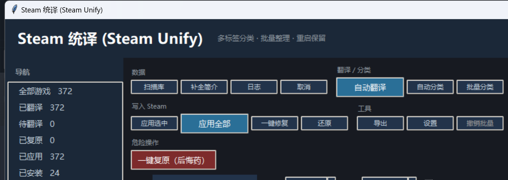

# Steam 统译 (Steam Unify)

[](https://github.com/moutou232/steam-unify/actions/workflows/tests.yml)

把 Steam 库里的游戏名补成简体中文，并按类型/标签自动分类（每个游戏最多 3 个分类），写入 Steam 收藏集；重启 Steam 后仍然保留。

本项目是一个 Windows 本地小工具：不需要安装 Python，便携 exe 下载即用；只读写本机 Steam 缓存，不读取、不上传账号密码或令牌。

> Steam Unify is a local Windows utility that translates game names and organizes a Steam library into multi-label collections. It writes only to the local Steam cache and includes backups and a one-click undo.



## 功能

- **自动补中文名**：Steam 官方简体中文名 → 内置词典 → Steam 商店/蒸汽平台名称 → MyMemory 机翻。
- **自动分类**：综合 Steam 类型、商店标签、简介关键词、名称关键词和本地词典，按权重取最多 3 个分类。
- **Steam 收藏集**：一个游戏最多进入 3 个收藏集；支持视觉小说、恐怖、肉鸽、模拟经营、RPG、动作、策略等分类。
- **手动编辑**：双击名称修改；双击分类列勾选最多 3 个分类、调整主分类、锁定分类。
- **批量操作**：复选框多选，批量追加/替换/移除分类；超 3 个自动截断并提示；可撤销上一次批量分类。
- **启动自动翻译**：新入库游戏可自动联网补名并分类，可在设置中关闭。
- **备份与一键复原**：应用前完整备份；一键复原会恢复原始英文名、清空分类、删除程序创建的收藏集，并自动重启 Steam。
- **重启保留**：直接写 Steam appinfo 缓存和收藏集，重启后名称/分类仍然存在。
- **无需 Python**：便携版 exe + `_internal`，解压即用。

## 下载

从 Releases 下载 Windows 便携版：

https://github.com/moutou232/steam-unify/releases/latest

```
Steam统译_便携版.zip
```

解压后运行 `Steam统译.exe`：

- 必须保留同目录的 `_internal` 文件夹，不能只单独拷走 exe；
- 首次运行会在 exe 旁边创建 `data` 和 `backups`；
- 建议先备份 Steam 库。

## 使用

1. 解压压缩包，双击 `Steam统译.exe`；
2. 等待扫描 Steam 库；
3. 检查中文名和分类，双击可编辑；
4. 点击“应用全部”或“应用选中”；
5. 程序会关闭 Steam、备份、写入并重新启动 Steam；
6. 重启 Steam 查看中文名和收藏集。

如果分类或名称被 Steam 更新覆盖，可以点“一键修复”；想重新开始，点“一键复原（后悔药）”。

## 从源码运行

需要 Windows + Python 3.10+（开发环境为 Python 3.13）。

```powershell
git clone https://github.com/moutou232/steam-unify.git
cd steam-unify
python run.py
```

项目只使用标准库和 tkinter，不需要安装第三方运行依赖。

构建便携版（需要 PyInstaller）：

```powershell
powershell -ExecutionPolicy Bypass -File build_exe.ps1
```

## 安全说明

- 仅修改本机 Steam 本地缓存，不读取、不保存、不上传 Steam 账号、密码、令牌或登录凭据。
- 应用前把 appinfo、收藏集、localconfig、ACF 备份到 `backups/`。
- 写入失败会回滚，并尽量重新启动 Steam。
- 游戏名写入 appinfo，本机所有账号共享；收藏集只写当前账号。
- 未签名 exe 可能触发 Windows SmartScreen，这是本地工具常见情况；源码公开，可自行审查/构建。
- 本工具不是 Valve/Steam 官方工具，与 Valve 无关；使用风险自担。

## 已知限制

- 翻译是官方名/词典/商店/机翻的组合，无法保证每个译名都符合个人偏好。
- 分类是启发式评分，不是大模型，不能保证 100% 准确；Steam 标签本身也有噪声。
- 简介关键词依赖 Steam 商店可访问性，无法访问时只使用标签/类型/名称/词典。
- Steam 客户端升级可能改变缓存格式；程序会校验格式，无法识别时拒绝写入。
- 不同账号共享 appinfo；收藏集属于当前登录账号。

## 工作原理

- 旧版 Steam：`appcache/appinfo.vdf`（v29）。
- 新版 Steam：`appcache/appinfo/appinfo_XX.vdf` 分片（v30），程序会同步索引偏移、数据大小和 CRC32。
- 兼容新出现的 81 字节索引记录及 4 字节索引前缀/后缀；单个无法识别的分片会跳过并记录警告，不会让整个扫描失败。
- 分类写入 `userdata/<account>/config/cloudstorage/cloud-storage-namespace-1.json` 的 Steam 收藏集记录。
- 状态保存在 `data/state.json`；`orig_name`、`orig_localized` 用于一键复原；所有分类最多 3 个。

## 项目结构

```
steam_zh/
  appinfo.py            旧版 appinfo.vdf 读写
  appinfo_shards.py     新版分片读写 + CRC
  apply.py              备份/应用/校验/还原/修复
  category_model.py     分类权重模型
  scoring.py            多标签评分
  category_state.py     v2 状态与 3 标签上限
  category_batch.py     批量分类
  undo.py               一键复原
  collections.py        Steam 收藏集
  translate.py          名称翻译
  gui.py / gui_dialogs.py / ui_widgets.py
data/                   内置词典和分类模型（不含个人状态）
tests/                  单元测试
docs/                   截图
```

`data/state.json`、`settings.json`、`backups/` 是运行数据，已加入 `.gitignore`，不会提交。

## 测试

```powershell
python -m unittest discover -s tests -v
```

测试覆盖多标签评分、批量截断、回滚、状态迁移、收藏集同步、原件不可覆盖等。依赖本机 Steam 缓存的测试在无 Steam 环境会自动跳过。

## 贡献

欢迎提交 Issue / PR，尤其是：

- 分类不准确的游戏（请附 AppID 和期望分类）；
- 翻译错误；
- Steam 客户端新格式的兼容问题；
- UI/交互改进。

## License

MIT

## 免责声明

本项目与 Valve Corporation / Steam 无关联。修改本地缓存有风险，请在使用前备份，并在了解风险的前提下自行决定是否使用。
